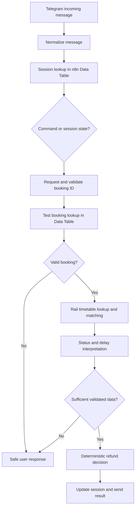

# Customer Service Refund Automation — n8n Case Study

**Portfolio case study | n8n · Telegram · JavaScript · REST APIs · Workflow State Management**

> **Project status:** Completed technical-assessment prototype. Not deployed to real customers. No real refunds were processed. This is an independent portfolio presentation of my technical work; it is not affiliated with or endorsed by the organization that provided the original assessment scenario.

## Project overview

This project demonstrates a customer-service automation prototype built with n8n. It combines conversational messaging, booking validation, rail-service information retrieval and deterministic refund-decision logic.

The objective was to demonstrate how a multi-step customer-service request can be processed through structured workflow automation while keeping financial decisions governed by explicit rules rather than AI-generated judgments.

## Technologies used

- **n8n:** Workflow orchestration, conditional routing and automation logic.
- **Telegram:** Customer-facing messaging interface.
- **JavaScript:** Data validation, matching, status interpretation and refund-decision logic.
- **n8n Data Tables:** Test booking lookups and chat-specific session management.
- **REST APIs:** HTTP requests for rail timetable and service information.

## Workflow architecture

This diagram summarizes the intended main processing path and important validation branches. It is a high-level explanation, not a complete execution trace of every node.

## Verified workflow structure

The primary workflow contains **52 n8n nodes**:

| Node type | Count |
|---|---:|
| Code | 10 |
| Data Table | 9 |
| HTTP Request | 4 |
| IF | 6 |
| No Operation | 2 |
| Set | 1 |
| Switch | 6 |
| Telegram | 13 |
| Telegram Trigger | 1 |
| **Total** | **52** |

The project also includes **16 separate development and testing workflows**. These supported individual implementation and verification tasks and were not independently deployed services.

## Implemented functionality

### Telegram messaging and session management

- Received incoming messages through a Telegram trigger.
- Used chat-specific session records and conversation-state routing.
- Supported session initialization, reset, prompts and result messages.

### Booking validation

- Extracted booking identifiers from incoming messages.
- Checked identifier syntax and performed lookups against test booking records.
- Routed invalid, missing or unsupported inputs through conditional response paths.

### Rail information processing

- Used HTTP Request nodes for rail timetable and service-information lookup stages.
- Applied JavaScript logic for station resolution, timetable matching and service-status interpretation.
- Included conditional handling for incomplete or unmatched information.

### Deterministic refund decisions

- Used JavaScript Code nodes to apply predefined prototype refund rules.
- Kept refund decisions separate from unconstrained AI-generated responses.
- Generated result messages without executing real financial transactions.

### Error handling

- Included conditional branches for invalid booking information, unsupported messages and insufficient rail data.
- Provided safe responses when a reliable outcome could not be established.

## Implementation and testing boundaries

| Category | Scope |
|---|---|
| **Implemented in the prototype** | Telegram messaging, session management, test booking validation, rail lookup stages, JavaScript matching and interpretation, deterministic refund decisions and conditional response handling. |
| **Offline-tested separately** | AI-based intent classification. It was not integrated into the primary n8n workflow. |
| **Not implemented or demonstrated for production** | Live customer booking integration, real refund execution, production-scale load testing, enterprise monitoring and production human escalation. |

The primary workflow used a temporary rule-based refund-intent gate rather than a production AI intent classifier.

The refund logic represents **prototype/test rules**, not an actual transport operator's refund policy.

## Design considerations

- **Deterministic financial decisions:** Explicit rules control refund outcomes.
- **Conversation isolation:** Chat-specific identifiers and state records separate conversations.
- **Validation before decision-making:** Booking and rail-service information are checked before the refund-decision stage.
- **Defensive routing:** Conditional branches handle missing, invalid or insufficient information.
- **Modular development:** Supporting workflows were used to develop and verify individual components.

## Limitations

- The prototype was not deployed to real customers.
- Booking records were test data, not live customer booking data.
- No real refunds were processed.
- Production reliability, scalability and accuracy were not independently established.
- External API credentials, underlying Data Table records and the execution environment are not included in this repository.

## Architecture artifact

The file `architecture/workflow-topology.json` contains a **sanitized, non-executable representation** of the primary 52-node workflow.

It includes generic node types and connection relationships but excludes original node names, JavaScript source, configuration parameters, API endpoints, credentials and dataset identifiers.

**This file cannot be imported into n8n as an executable workflow.**

## Repository contents

- `README.md` — project overview, architecture and implementation boundaries.
- `docs/workflow-inventory.md` — technical workflow overview and verified implementation scope.
- `architecture/workflow-topology.json` — sanitized, non-executable node-and-edge topology.
- `.gitignore` — repository file-exclusion rules.

## Portfolio scope

This repository documents a technical prototype and its architecture. It does not contain the original executable workflow exports, embedded JavaScript source, credentials, private datasets or a hosted demonstration.

The project is presented as independent technical portfolio work, without claiming production deployment, organizational endorsement or implementation for real customers.
